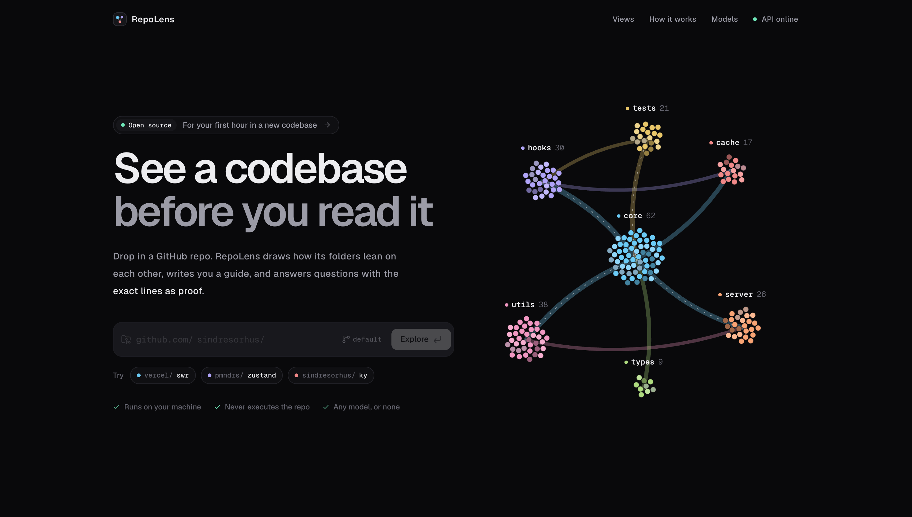
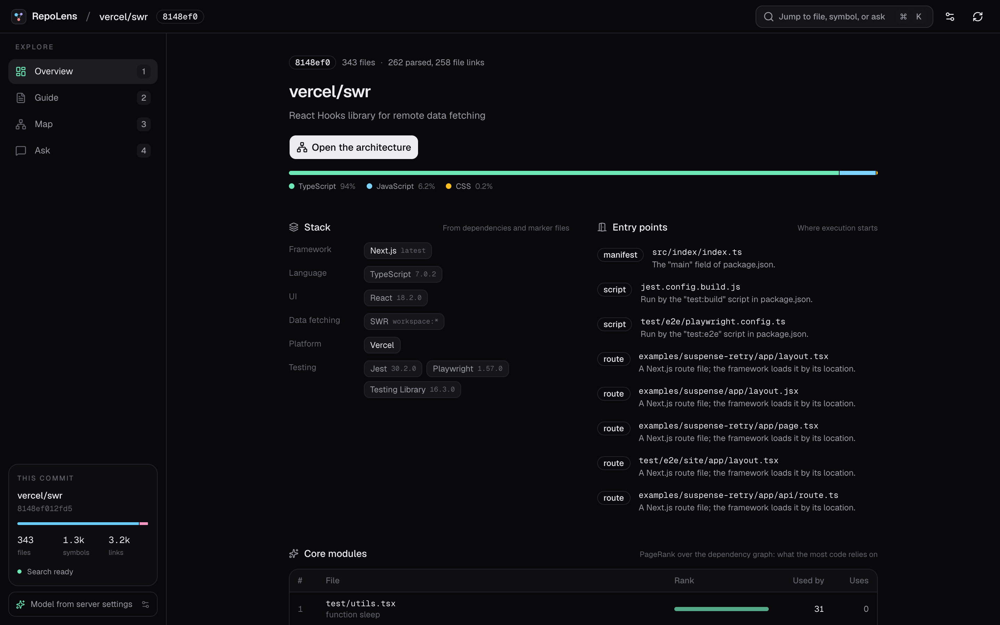
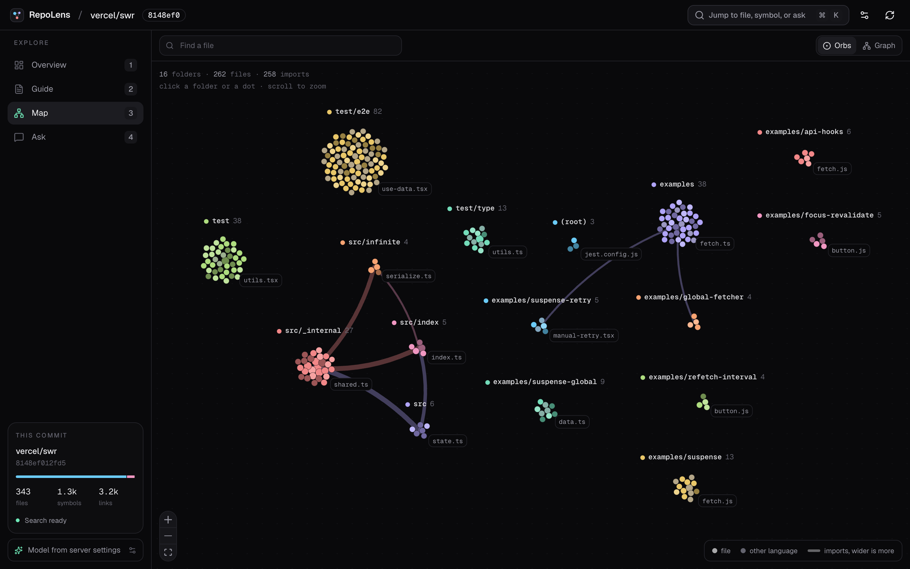
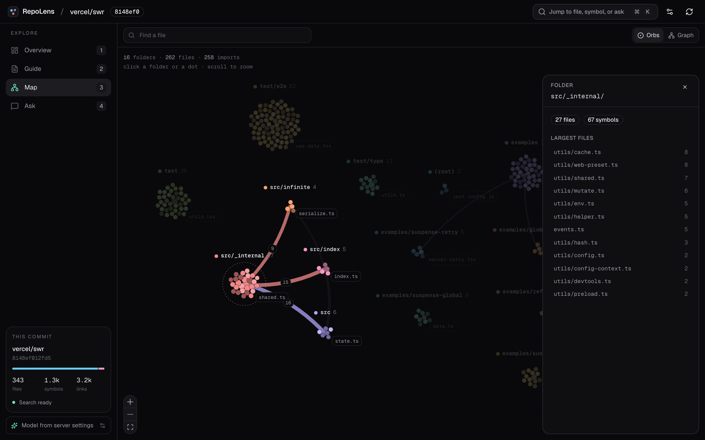
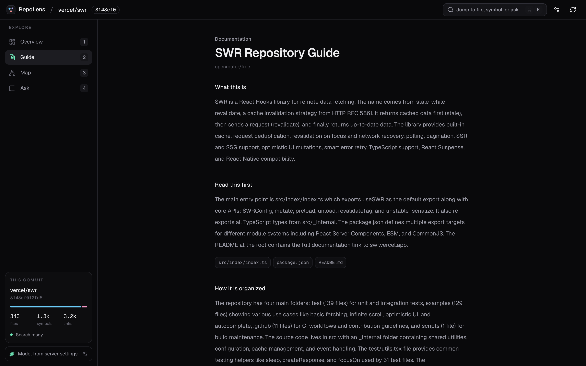

# RepoLens

RepoLens reads a public GitHub repository at one commit and helps you understand it. It stores the snapshot, maps TypeScript and JavaScript relationships, and answers questions with citations that point at exact lines.

Search works without a language model. Keyword search and local code embeddings in PostgreSQL (pgvector) find the evidence. A chat model is optional. When one is configured, every paragraph still has to cite that evidence.

The repository code is never executed.



## What you get

The screenshots show [vercel/swr](https://github.com/vercel/swr) at commit `8148ef0`.

### Overview

Stack, entry points, core modules, and folder roles, read from the files and the import graph. The sidebar shows the commit, its counts, whether search is ready, and the chat model. Keys 1 to 4 switch views.



### Map

One dot per file, one cluster per folder. A band joins two folders when one imports from the other, and it grows with the number of imports. Small folders fold into their parent so the map stays readable. Muted dots are files in another language than the rest of their folder.



Click a folder to fade everything it is not linked to and see the import count on each band. Click a dot to see that file's declarations and the files it imports or is imported by. The Graph switch draws the same files as labeled cards.



### Guide

A short written tour of the commit, with links back to the files it used. Without a chat model it is built from the README, the package manifest, folder names, and import counts.



### Ask

A question answered from retrieved source. Open "How this answer was built" to see the keyword hits, the vector hits, and the fused ranking. A citation opens those lines. Answer quality depends on the chat model; see [Choosing a model](#choosing-a-model).

Every view also links into the source drawer, and `?view=map` (or `overview`, `guide`, `ask`) opens a workspace on that view.

## Limits

- The relationship graph covers TypeScript and JavaScript. Other languages are stored and can be searched. They are not drawn as a graph.
- Ingestion accepts `https://github.com/{owner}/{name}` only.
- A hosted chat model, once you configure one, receives the retrieved excerpts. Leave the provider unset and nothing is sent.

## Run with Docker

Docker Compose starts PostgreSQL 18 with pgvector, the API, and the web app.

```bash
docker compose up --build
```

Open [http://localhost:3000](http://localhost:3000). The API listens on port 8000. Do not start Compose while another PostgreSQL is already using port 5432.

`docker compose --profile ollama up --build` also starts Ollama. You still choose the model in the app.

Inside Docker, `127.0.0.1` is the API container, not your machine. In the model dialog, use one of these base URLs:

- `http://ollama:11434` for the Ollama started by the `ollama` profile. Pull a model into it first with `docker compose exec ollama ollama pull qwen2.5-coder:7b`.
- `http://host.docker.internal:11434` for an Ollama already running on your machine.

Compose passes `apps/api/.env` to the API at run time when that file exists. `.dockerignore` keeps it, and any `node_modules` or `.venv` from local development, out of the images. The local embedding model is downloaded once into the `repolens-models` volume.

## Choosing a model

RepoLens does not ship or host a model. Pick one of these:

| Setup | What works | Where source goes |
| --- | --- | --- |
| No model | Overview, Map, source, keyword and vector search. Ask quotes the matching lines. The Guide is built from the README, manifest, and imports. | Nowhere |
| Local Ollama | Everything, with written answers and a written Guide | Stays on your machine |
| Hosted, OpenAI-compatible (OpenAI, OpenRouter, and others) | Everything, usually with the best answers | Retrieved excerpts are sent to that provider |

Set the model with the model button in the app, or set `REPOLENS_CHAT_BASE_URL`, `REPOLENS_CHAT_MODEL`, and `REPOLENS_CHAT_API_KEY` in `apps/api/.env`. A model saved in the app wins. For a hosted provider, the base URL includes the API version, for example `https://api.openai.com/v1` or `https://openrouter.ai/api/v1`.

Answer quality depends on the model. RepoLens keeps only paragraphs that cite retrieved lines. A model that ignores the citation format gets its answer replaced by quoted lines, so small or free models often look terse. A larger instruction-following model cites more reliably. No particular model has been benchmarked here.

## Local development

- Node.js 20.9 or newer
- [Bun](https://bun.sh) 1.3.2
- [uv](https://docs.astral.sh/uv/) 0.13 or newer (it installs CPython 3.12 for the API)
- PostgreSQL 18 with the `vector` extension

```bash
cd apps/api && uv sync
cd ../web && bun install
cd ../analyzer && bun install
```

Create the databases and enable pgvector in both:

```bash
createdb repolens
createdb repolens_test
psql -d repolens -c "CREATE EXTENSION IF NOT EXISTS vector"
psql -d repolens_test -c "CREATE EXTENSION IF NOT EXISTS vector"
```

Copy what you need from `.env.example`. The API reads `DATABASE_URL` from `apps/api/.env` or from the environment. The default web app calls `http://127.0.0.1:8000`.

Start the API:

```bash
cd apps/api
uv run uvicorn app.main:app --reload --host 127.0.0.1 --port 8000
```

Start the web app in a second terminal:

```bash
cd apps/web
bun run dev
```

Open [http://localhost:3000](http://localhost:3000). Node.js must be on `PATH`. The API runs `apps/analyzer/parse.mjs` during analysis. The first analysis downloads the local embedding model `jinaai/jina-embeddings-v2-base-code` (768 dimensions).

`GET /health` returns `{"status":"ok"}` when the API process is up. It does not check PostgreSQL.

## Configuration

See `.env.example`.

- `GITHUB_TOKEN` is optional and is sent only to `api.github.com`.
- `REPOLENS_EMBEDDING_BASE_URL` replaces the local embedding model with an OpenAI-compatible endpoint that returns 768-dimensional vectors.
- `REPOLENS_RERANKER=1` adds a local cross-encoder after hybrid search. It is off by default.
- `REPOLENS_CHAT_BASE_URL` and `REPOLENS_CHAT_MODEL` supply a chat model when none is saved in the app. Keys stay on the server. `GET /provider` and `GET /config` do not return them.

## Checks

```bash
cd apps/api && uv run pytest
cd apps/web && bun run lint && bun run typecheck && bun run build
```

`bun run e2e` in `apps/web` needs Playwright Chromium (`bunx playwright install chromium`) and the web app at `http://localhost:3000`.

## Layout

```text
apps/web/         Next.js workspace
apps/api/         FastAPI application
apps/analyzer/    TypeScript parser invoked by the API
docs/             Architecture, threat model, and decision records
evaluation/       Golden-question datasets for retrieval scoring
```

`docs/architecture.md` describes the request flow. `docs/threat-model.md` describes what the controls do and do not cover.

## License

[MIT](LICENSE)
